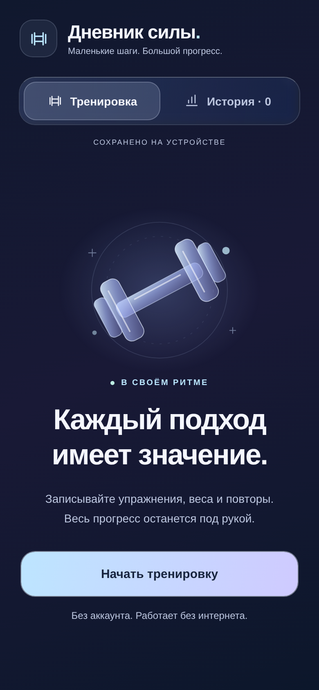

# Fitness — Дневник силы

Приложение на русском языке для записи тренировок на Android и iOS. Один проект на React Native, Expo и TypeScript; веб-версия служит также для проверки интерфейса.

## Дизайн

Тёмный glassmorphism: сине-сиреневый фон, полупрозрачные панели с тонкими светлыми границами и градиентные кнопки. На iOS и в браузере используется размытие; на Android — более плотная полупрозрачная подложка. Системная настройка iOS «Понижение прозрачности» заменяет стекло непрозрачными панелями.



Чтобы получить новый дизайн, скачайте свежий архив проекта и заново запустите `start-iphone.cmd` на Windows. При запуске вручную сначала выполните `npm ci`, затем `npx expo start --clear --lan`. Данные дневника и ключ хранения не менялись.

## Что умеет

- Начать тренировку и выбрать упражнение из каталога или добавить своё название тренажёра.
- Записать вес (кг) и повторы для каждого подхода. Дробный вес принимается с запятой или точкой; 0 кг означает упражнение с собственным весом.
- Исправить или удалить подход, удалить упражнение с подтверждением.
- Восстановить незавершённую тренировку после закрытия приложения.
- Завершить тренировку и посмотреть упражнения, подходы и общий объём в истории.
- Работать без аккаунта и интернета. Данные сохраняются локально; синхронизации и резервных копий пока нет. Удаление приложения может удалить записи.

## Запуск на телефоне

Нужны Node.js 24, npm и Expo Go для Android или iOS, совместимый с Expo SDK 58.

```sh
npm ci
npm start
```

На компьютере и телефоне должна быть доступна одна сеть. Откройте проект по QR-коду из терминала: на Android через Expo Go, на iPhone через камеру. Для работы без Expo Go понадобится отдельная подписанная сборка. Бинарники APK/IPA пока не создавались; для публикации нужны аккаунты разработчика и настройка подписей. iOS-симулятор требует macOS и Xcode; Android-эмулятор — Android Studio/SDK.

## Проверки

```sh
npm run typecheck
npm test
npm run export
npx playwright install chromium
npm run test:e2e
```

Экспорт собирает JS/Hermes-пакеты Android/iOS и веб-версию в `dist`, но не заменяет нативную сборку или тест на телефоне. E2E проверяет создание упражнения, валидацию, редактирование подхода, восстановление черновика и истории после перезагрузки и отмену удаления. Для тестового веб-сервера нужен Python 3. Для проверки с работающим Metro вместо статического экспорта задайте `E2E_DEV_SERVER=1`.

## Особенности этой облачной среды

Кэши перенесены в доступный для записи `/workspace`; это не требуется при обычном локальном запуске:

```sh
export npm_config_cache=/workspace/.npm
export __UNSAFE_EXPO_HOME_DIRECTORY=/workspace/.expo-home
export XDG_CACHE_HOME=/workspace/.cache
export EXPO_NO_TELEMETRY=1
export EXPO_UNSTABLE_HEADLESS=1
export EXPO_OFFLINE=1
npm ci
npm run web -- --host lan --port 8082
```

`EXPO_OFFLINE=1` позволяет работать без обращения к API Expo; зависимости берутся из npm. `__UNSAFE_EXPO_HOME_DIRECTORY` используется только в оболочке для собственного каталога настроек Expo, не задавайте его в `.env`. Не копируйте туда чужие файлы авторизации.

Для E2E в этой среде установлен системный Chromium:

```sh
CHROMIUM_PATH=/usr/bin/chromium npm run test:e2e
```

В каждой облачной задаче уже есть изолированная рабочая копия. Используйте её, не создавайте Git worktree без явного запроса.

## Установка на iPhone и TestFlight

Пошаговая инструкция: [IOS.md](IOS.md). Профиль `production` в `eas.json` предназначен для подписанной сборки App Store/TestFlight. Готовая ссылка TestFlight появится только после подключения ваших аккаунтов, успешной сборки, загрузки и необходимых проверок Apple.
